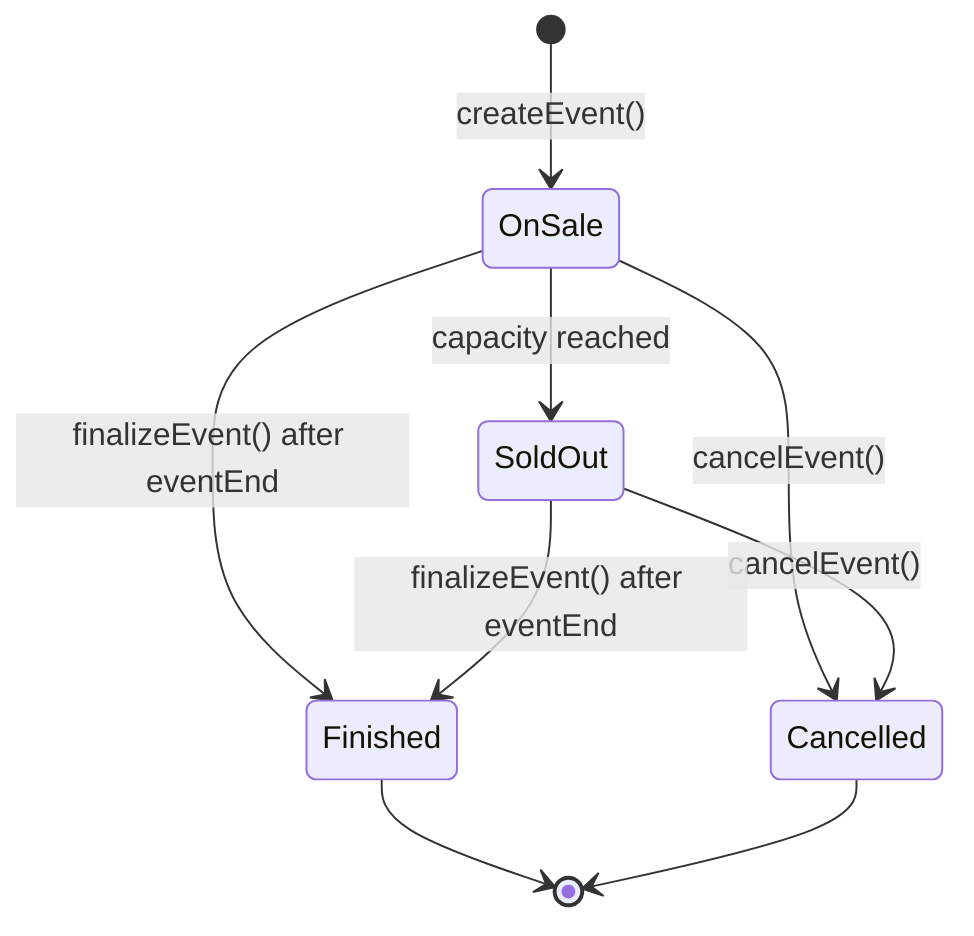

# CSIT5760 — Blockchain and Smart Contracts

## PROJECT PROPOSAL

| Field | Value |
|---|---|
| Project title | EscrowTick: Escrow-Based Ticketing with Refundable No-Show Deposits for Small Club Events |
| Student name | [YOUR FULL NAME] |
| Student ID | 21316347 |
| Instructor | [INSTRUCTOR NAME] |
| Submission date | 10 November 2026 |
| Repository URL | https://github.com/hohq/Blockchain_big |
| Testnet / network | Sepolia (chain ID 11155111) |

## 1. Project Title

EscrowTick: Escrow-Based Ticketing with Refundable No-Show Deposits for Small Club Events

## 2. Background and Motivation

Student clubs run ticketing events with capacities in the tens. Because these events are informal and low-budget, organisers rely on group-chat sign-up lists and personal payment QR codes. Such lists cannot enforce capacity, so events are routinely over-booked on paper and under-attended in practice; payments cannot be matched to names at the door; and refunds must be transferred by hand, one attendee at a time. Organisers absorb the cost of empty seats, students are turned away while half the room stays empty, and neither side is acting in bad faith — the problem is that neither can make a credible commitment to the other. The significance lies in frequency: a single deposit is a few dollars, but a society runs dozens of such events each year.

**Users and stakeholders.** Organisers need predictable attendance; attendees need a low-effort way to recover their deposit; check-in volunteers verify attendance at the door; student development offices allocate funding on attendance; community groups face the same constraints outside a university.

**Limitations of existing approaches.** Group-chat lists cannot enforce capacity or handle money. Online forms can cap responses but cannot collect or refund money. Commercial platforms (Eventbrite, 活动行) target commercial events, charge listing and payment fees, and hold funds until after the event, executing refund rules at their own discretion. Payment QR codes are irreversible and cannot be linked to an attendance. University systems are closed to informal clubs. Each alternative either cannot hold money, or holds it in a way that requires trust in the holder.

**Why blockchain.** A database can record a capacity limit and a refund policy; it cannot make the *execution* of that policy independent of the party holding the money. In every alternative above, the organiser or the platform holds the deposits and decides whether and when to return them. A smart contract changes the trust structure: the deposit is held by code, and the release conditions — check in and it returns, fail to appear and it is forfeited, cancel and everything is refunded — are fixed when the event is created and visible to every buyer before they pay. This is the condition under which on-chain escrow is preferable to a database: opposed interests, no mutually trusted intermediary, and a payment released by a rule rather than by a judgement.

## 3. Project Objectives

| ID | Measurable objective | Success criterion |
|---|---|---|
| O1 | **Develop** a Solidity 0.8.x contract enabling approved organisers to publish events and students to buy tickets, with capacity enforced on-chain. | An event with capacity *N* accepts exactly *N* purchases and rejects the (*N*+1)-th with a custom error; each purchase emits `TicketPurchased`. |
| O2 | **Implement** escrow settlement in which ticket payments and deposits are released only according to event outcome. | Check-in, no-show and cancellation scenarios change each party's balance by exactly the expected amount; after settlement the contract balance is zero. |
| O3 | **Enforce** role-based access control and explicit lifecycle state machines. | Every state × operation pair is tested: valid transitions succeed, invalid ones revert with the specified error; unauthorised accounts cannot create, check in or withdraw. |
| O4 | **Validate** the contract with a Hardhat suite covering positive, negative and boundary cases. | ≥ 50 tests pass in one `npx hardhat test` run with ≥ 85% statement coverage, documented in the required Test ID / Purpose / Preconditions / Input / Expected / Actual / Status format. |
| O5 | **Perform** static analysis and manual security review, and remediate findings. | A Slither report with tool version is produced; every finding is triaged with severity and remediation; all High and Medium findings are fixed and re-tested. |
| O6 | **Deploy** the final contract to Sepolia and verify it on Etherscan. | Verified address, transaction hash, block number, compiler and optimiser settings are recorded; the README lets a new user reproduce deployment and interaction. |

## 4. Proposed System and Scope

**Roles and permissions.**

| Role | Permissions |
|---|---|
| Administrator (deployer) | Approve or revoke organisers; pause new purchases. **Cannot move, withdraw or redirect user funds.** |
| Organiser | Create events; set capacity, price, deposit and deadlines; nominate a check-in delegate; check in attendees; finalise or cancel own events; withdraw settled revenue. |
| Check-in delegate | Check in attendees for one nominated event only. |
| Attendee | Buy while the sale is open; cancel before the deadline; withdraw refunds and returned deposits. |

**Principal functions.** `approveOrganizer` / `revokeOrganizer` (admin); `createEvent`, `finalizeEvent`, `cancelEvent` (organiser); `buyTicket` *(payable, requires `price + deposit`)*, `cancelRegistration`, `withdraw` (attendee); `checkIn` (organiser or delegate); `setPaused` (admin); views `getEvent`, `getTicket`, `pendingBalanceOf`.

**On-chain and off-chain.** On-chain: event parameters and state, ticket ownership and check-in status, escrowed balances and settlement, metadata URI. Off-chain: descriptions and images, venue details, attendee names and contact details, QR codes. Personal data is deliberately kept off-chain — a public blockchain cannot delete, so names and identifiers would be a permanent privacy leak, and the contract only needs to know *that* a wallet holds a ticket, not *who* the person is.

**Events and access control.** `OrganizerApproved`, `EventCreated`, `TicketPurchased`, `RegistrationCancelled`, `AttendeeCheckedIn`, `EventFinalised`, `EventCancelled`, `RefundCredited`, `Withdrawal`, `Paused`/`Unpaused`. Modifiers: `onlyAdmin`, `onlyApprovedOrganizer`, `onlyEventOrganizer`, `onlyCheckInAuthority`, `whenNotPaused`.

**Ether, tokens and NFTs.** Native Ether only. No ERC-20 (a stablecoin dependency adds approval and price concerns with no benefit for small deposits). No ERC-721: a ticket must not be transferable, so a token standard would need its transfer logic overridden purely to disable it; internal records give the same guarantee with less code and a smaller attack surface.

**Exclusions and assumptions.** Excluded: secondary market and resale, anti-scalping caps, reputation scoring, ERC-20 or fiat rails, dispute arbitration (no arbiter is needed because the decisive fact — whether an attendee checked in — is a boolean on-chain, not a judgement), mobile application. Assumed: the administrator approves organisers as a lightweight onboarding gate; check-in is performed honestly by someone who can observe attendance; attendees hold test ETH; capacity is bounded so UI queries stay manageable.

## 5. Preliminary Smart Contract Design

| Component | Planned design | Purpose / rule |
|---|---|---|
| Structure | One `EventTicketing` contract; events keyed by `uint256 eventId` | One deployment serves every club |
| State | `events`, `tickets[eventId][attendee]`, `approvedOrganizers`, `pendingBalance`, `paused`, `nextEventId` | Complete state of events, tickets, roles and owed funds |
| Structs | `Event { organizer, capacity, sold, checkedIn, price, deposit, saleEnd, eventEnd, state, metadataURI, delegate, settled }`; `Ticket { paid, deposit, checkedIn, refunded }` | Configuration plus per-ticket status |
| Enum | `EventState { OnSale, SoldOut, Finished, Cancelled }` | Explicit lifecycle; every mutation checks state |
| Modifiers / errors | `onlyAdmin`, `onlyEventOrganizer`, `onlyCheckInAuthority`, `whenNotPaused`; custom errors such as `SoldOut`, `SaleClosed`, `AlreadyCheckedIn` | Access control and testable failure modes |
| Settlement | Purchase credits `price + deposit`; check-in credits the deposit back; finalisation credits the organiser `sold × price + (sold − checkedIn) × deposit`; cancellation credits every attendee `price + deposit` | Accounts reconcile exactly; balance reaches zero after all withdrawals |
| Payouts | Pull payments: credits accumulate in `pendingBalance`, withdrawn by the account itself | Avoids push-transfer reentrancy and gas-bounded loops |
| Complexity | O(1) settlement using `sold` and `checkedIn` counters; no iteration over attendees anywhere | No unbounded loop, therefore no denial of service through a large attendee list |

### 5.1 Architecture or Workflow

An approved organiser creates an event, which opens for sale. Attendees pay `price + deposit`, held by the contract; before the deadline they may cancel and be credited in full. At the door the organiser or delegate checks attendees in, crediting each deposit for withdrawal. After the event the organiser finalises and receives revenue plus the deposits of those who did not appear. If the event is cancelled first, every attendee is credited and the organiser receives nothing. In every branch, contract liability equals the sum of pending balances and both reach zero after all withdrawals.

## 6. Technology Stack

| Technology / version | Purpose | Rationale |
|---|---|---|
| Solidity 0.8.24 | Contract language | Checked arithmetic, custom errors |
| Hardhat 2.22.x | Compile, test, deploy | Time manipulation (`evm_increaseTime`) for deadline tests |
| OpenZeppelin Contracts 5.x — `Ownable`, `Pausable`, `ReentrancyGuard` | Access control, pause, reentrancy protection | Audited, widely used; behaviour still documented |
| ethers.js 6.x / Node.js 20 LTS | Scripts and runtime | Integrated with Hardhat |
| MetaMask + Sepolia (chain ID 11155111) | Wallet and deployment target | Course-approved network |
| Etherscan (Sepolia) | Source verification | Required evidence |
| Slither 0.10.x / solidity-coverage | Static analysis and coverage | Evidence for O4 and O5 |

## 7. Security Considerations

| Risk | Attack / failure scenario | Mitigation | Validation |
|---|---|---|---|
| Reentrancy on withdrawal | A malicious attendee re-enters `withdraw()` to drain other users' balances | Balance zeroed before transfer (checks-effects-interactions); `ReentrancyGuard` | Attacker contract asserts the nested call reverts and balances are unchanged |
| Unauthorised check-in | Anyone calls `checkIn(eventId, ownAddress)` to reclaim the deposit without attending | Restricted to the event organiser or its delegate, checked per event | Negative tests from attendee, other organiser and admin |
| Overselling race | Two purchases in one block both read the pre-increment `sold` | Capacity incremented and `SoldOut` set within the same transaction; no off-chain counter trusted | Two signers in one block: exactly one succeeds |
| Premature withdrawal | Organiser calls `finalizeEvent` before the event, taking revenue and forfeiting nothing | Requires `block.timestamp > eventEnd` and a non-cancelled state | Boundary tests at `eventEnd − 1`, `eventEnd`, `eventEnd + 1` |
| Refund denial of service | A loop over attendees runs out of gas, leaving later attendees unpaid | Pull payments; no function iterates over attendees | Maximum-capacity cancellation leaves every refund claimable |
| Pause blocking refunds | Administrator pauses and attendees can no longer recover their money | Pause gates only `buyTicket` and `checkIn` | Test that `withdraw()` succeeds while paused |

## 8. Testing Plan

| Test category | Representative scenario | Expected evidence |
|---|---|---|
| Positive | Three attendees buy, all check in, organiser finalises | Deposits returned, revenue correct, contract balance zero; expected events emitted |
| Negative | Unapproved account calls `createEvent`; purchase after `saleEnd` | Reverts with `NotAnOrganizer` and `SaleClosed`; no state change |
| Boundary | Purchases at capacity *N* and *N*+1; purchase at the deadline and one second later | *N*-th succeeds, (*N*+1)-th reverts with `SoldOut`; deadline behaviour defined and tested |
| Boundary | `finalizeEvent` at `eventEnd − 1`, `eventEnd`, `eventEnd + 1` | Only the third succeeds; the first two revert |
| State transitions | Event cancelled after several sales | Every attendee credited `price + deposit`; organiser receives nothing; purchases revert |
| Access control | Every privileged function called from every role | Each unauthorised combination reverts with the specified error |
| Reentrancy and invariant | Nested withdrawal attempt; arbitrary operation sequences | Nested call reverts; `balance ≥ Σ pendingBalance`, and both are zero after full settlement |

## 9. Work Plan

| Phase | Activities | Target date | Deliverable |
|---|---|---|---|
| 1. Design | Finalise state machines, accounting and access matrix | 11–13 Nov 2026 | Design notes and diagram |
| 2. Contract development | Implement `EventTicketing` with OpenZeppelin components | 14–18 Nov 2026 | Compiling contract |
| 3. Unit testing | Positive, negative, boundary, state and access tests; coverage | 19–22 Nov 2026 | ≥ 50 tests, ≥ 85% coverage |
| 4. Security review | Slither plus manual review | 23–24 Nov 2026 | Security report with triaged findings |
| 5. Remediation and retesting | Fix High/Medium findings, add regression tests, re-scan | 25–26 Nov 2026 | Remediation log and clean scan |
| 6. Deployment and verification | Deploy to Sepolia, record deployment data, verify on Etherscan | 27 Nov 2026 | `deployment-information.txt`, verified URL |
| 7. Report and submission | Write report, README, screenshots; checklist | 28–30 Nov 2026 | Submitted ZIP |

## 10. References

[1] CSIT5760 Course Instructor, "CSIT5760 Blockchain and Smart Contracts — Individual Project Guidelines," Academic Year 2026–2027, 5 November 2026. [Accessed: 9 Nov. 2026].

[2] Solidity Team, "Solidity Documentation," v0.8.24, 2026. [Online]. Available: https://docs.soliditylang.org. [Accessed: 9 Nov. 2026].

[3] OpenZeppelin, "OpenZeppelin Contracts 5.x Documentation," 2026. [Online]. Available: https://docs.openzeppelin.com/contracts/5.x. [Accessed: 9 Nov. 2026].

[4] Nomic Foundation, "Hardhat Documentation," 2026. [Online]. Available: https://hardhat.org/docs. [Accessed: 9 Nov. 2026].

[5] Crytic, "Slither: Static Analyzer for Solidity," 2026. [Online]. Available: https://github.com/crytic/slither. [Accessed: 9 Nov. 2026].

[6] Etherscan, "Sepolia Testnet Explorer," 2026. [Online]. Available: https://sepolia.etherscan.io. [Accessed: 9 Nov. 2026].

[7] Eventbrite, "Organizer Fees," 2026. [Online]. Available: https://www.eventbrite.com/organizer/fees/. [Accessed: 9 Nov. 2026].

<!-- Acknowledge AI-assisted material here in the form required by the course policy (guidelines, Section 13). -->

## Proposal Submission Checklist

- ☐ Approximately 2–3 pages excluding references
- ☐ Scope is achievable before 30 November 2026
- ☐ At least three security risks are addressed
- ☐ Testing includes positive, negative, and boundary cases
- ☐ All third-party sources and libraries are acknowledged
- ☐ No private keys, seed phrases, or credentials are included
