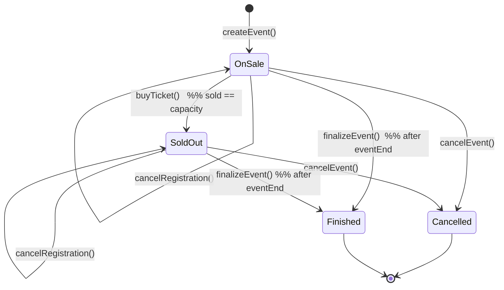

# CSIT5760 — Blockchain and Smart Contracts

## PROJECT PROPOSAL

**Individual Project Template**

| Field | Value |
|---|---|
| Project title | EscrowTick: Escrow-Based Ticketing with Refundable No-Show Deposits for Small Club Events |
| Student name | [YOUR FULL NAME] |
| Student ID | 21316347 |
| Instructor | [INSTRUCTOR NAME] |
| Submission date | 10 November 2026 |
| Repository URL | [YOUR REPOSITORY URL] |
| Testnet / network | Sepolia (chain ID 11155111) |

---

## 1. Project Title

EscrowTick: Escrow-Based Ticketing with Refundable No-Show Deposits for Small Club Events

---

## 2. Background and Motivation

### The problem

Student clubs and small community organisations run ticketing events — workshops, film screenings, competitions, socials — with capacities in the tens rather than the thousands. Because these events are informal and low-budget, organisers rely on group-chat sign-up lists and personal payment QR codes. This works until it does not.

Sign-up lists cannot enforce capacity, so events are routinely over-subscribed on paper and under-attended in practice: a substantial share of those who reserved a place simply do not appear, and the places cannot be reallocated in time. Payments arrive as anonymous transfers that cannot be matched to names at the door. Refunds require the organiser to transfer money back by hand, one attendee at a time — a task that is unpopular, error-prone, and frequently abandoned.

The result is a coordination failure that harms everyone. Organisers absorb the cost of empty seats and buy refreshments for people who never arrive. Students who wanted to attend are turned away from a full list while half the room stays empty. Neither side is acting in bad faith. The problem is that neither side can make a credible commitment to the other.

The significance lies in frequency rather than value. A single deposit may be a few dollars, but a typical student society runs dozens of such events each year, and the same pattern repeats across every club, department, and small community group.

### Intended users and stakeholders

- **Club organisers** create events, set capacity, price and deposit, and need attendance to be predictable.
- **Student attendees** pay in advance and need a reliable, low-effort way to recover their deposit.
- **Check-in volunteers** verify attendance at the door, typically on a phone and under time pressure.
- **Secondary stakeholders** include student development offices that allocate funding on the basis of attendance, and community groups and NGOs that face the same constraints outside a university.

### Limitations of existing approaches

| Approach | Limitation |
|---|---|
| Group-chat sign-up lists | No capacity enforcement; duplicate entries; no payment; no durable record; disputes unresolvable |
| Online forms (Google Forms, 问卷星) | Can cap responses, but cannot collect or refund money, and cannot bind a response to a payer |
| Commercial ticketing platforms (Eventbrite, 活动行, 大麦) | Designed for commercial events; charge listing and payment fees; require business accounts; hold funds until after the event; refund rules are executed by the platform at its discretion |
| Personal payment QR codes | Effectively irreversible; no link between a payment and an attendance; refunds require manual transfers; no audit trail |
| University event systems | Restricted to official departments; no deposit or no-show mechanism; unavailable to informal clubs |

Each alternative either cannot hold money, or holds it in a way that requires the participant to trust the holder.

### Why blockchain adds value beyond a conventional database

A conventional database, or a hosted ticketing service, can record a capacity limit and a refund policy. What it cannot do is make the *execution* of that policy independent of the party holding the money. In every alternative above, the organiser or the platform holds the deposits and decides whether and when to return them. Students must therefore trust the organiser; organisers must chase attendees who do not appear; and any platform inserted between them becomes a third party that must itself be trusted with money, and charges for that trust.

A smart contract changes the trust structure rather than the user interface. The deposit is held by code, not by a person. The release conditions — check in and the deposit is returned; fail to appear and it is forfeited to the organiser; cancel the event and every payment is refunded in full — are fixed when the event is created and are visible to every buyer before they pay. Neither the organiser nor a platform can alter them afterwards, and neither can abscond with the balance.

This is precisely the condition under which on-chain escrow is preferable to a database: participants with opposed interests, no mutually trusted intermediary, and a payment that must be released according to a rule rather than a judgement. The scope is deliberately narrow — the contract is the escrow and the rulebook, not a marketplace. Resale, anti-scalping and reputation systems are excluded because small club events do not experience them.

---

## 3. Project Objectives

| Objective ID | Measurable objective | Success criterion |
|---|---|---|
| O1 | **Develop** a Solidity 0.8.x contract that enables approved club organisers to publish ticketing events and enables students to purchase tickets, with capacity limits enforced on-chain. | An event created with capacity *N* accepts exactly *N* purchases and rejects the (*N*+1)-th with a defined custom error; every successful purchase emits a `TicketPurchased` event containing `eventId`, `buyer` and ticket information. |
| O2 | **Implement** escrow-based settlement in which ticket payments and refundable deposits are held by the contract and released only according to the event outcome. | In scripted check-in, no-show and cancellation scenarios, attendee, organiser and contract balances change by exactly the expected amounts; after settlement and withdrawal the contract balance returns to zero. |
| O3 | **Enforce** role-based access control and explicit lifecycle state machines for events and tickets. | Every state × operation combination is tested: all valid transitions succeed and all invalid ones revert with the specified custom error; unauthorised accounts cannot create events, check in attendees, or withdraw funds. |
| O4 | **Validate** the contract with an automated Hardhat test suite covering positive, negative and boundary cases. | At least 50 test cases pass in a single `npx hardhat test` run, covering every public function; statement coverage is at least 85% as reported by `solidity-coverage`; test cases are documented in the required Test ID / Purpose / Preconditions / Input / Expected / Actual / Status format. |
| O5 | **Perform** static analysis and manual security review of the contract, and remediate the findings. | A Slither report is produced with the tool version and command recorded; every finding is triaged with severity and remediation; all High and Medium findings are resolved and re-tested, with evidence included. |
| O6 | **Deploy** the final contract to the Sepolia testnet and verify its source code on Etherscan. | A verified contract address, deployment transaction hash, block number, compiler version and optimiser settings are recorded; the README enables a new user to reproduce deployment and interact with the contract. |

---

## 4. Proposed System and Scope

### User roles and permissions

| Role | Who | Permissions |
|---|---|---|
| Platform administrator | Contract deployer | Approve or revoke organisers; pause new purchases in an emergency. **Cannot move, withdraw or redirect user funds.** |
| Organiser | Approved club account | Create events; set capacity, price, deposit and deadlines; nominate a check-in delegate; check in attendees; finalise or cancel its own events; withdraw settled revenue. |
| Check-in delegate | Address nominated per event by the organiser | Check in attendees for that event only. |
| Attendee | Any wallet address | Purchase a ticket while the sale is open and capacity remains; cancel before the cancellation deadline; withdraw refunds and returned deposits. |

### Principal smart-contract functions

| Function | Caller | Behaviour |
|---|---|---|
| `approveOrganizer(address)` / `revokeOrganizer(address)` | Administrator | Maintains the organiser allow-list. |
| `createEvent(name, capacity, price, deposit, saleStart, saleEnd, eventEnd, metadataURI)` | Organiser | Creates an event in `OnSale` state and emits `EventCreated`. |
| `buyTicket(uint256 eventId) payable` | Attendee | Requires `msg.value == price + deposit`; enforces capacity and sale window; records the ticket. |
| `cancelRegistration(uint256 eventId)` | Attendee | Before the cancellation deadline; credits `price + deposit` to the attendee's pending balance and frees the place. |
| `checkIn(uint256 eventId, address attendee)` | Organiser or delegate | Marks the ticket attended and credits the deposit back to the attendee. |
| `finalizeEvent(uint256 eventId)` | Organiser | Only after `eventEnd`; credits the organiser with `sold × price` plus `(sold − checkedIn) × deposit` for forfeited deposits. |
| `cancelEvent(uint256 eventId)` | Organiser | Before the event begins; credits every attendee with `price + deposit` and marks the event `Cancelled`. |
| `withdraw()` | Any account with a pending balance | Pull-payment withdrawal; clears the balance before transferring. |
| `setPaused(bool)` | Administrator | Blocks new purchases only; refunds and withdrawals remain available. |
| View functions | Anyone | `getEvent`, `getTicket`, `pendingBalanceOf`, `isApprovedOrganizer`. |

### On-chain and off-chain information

**On-chain (public, permanent):** event parameters (capacity, price, deposit, sale and event timestamps, state), ticket ownership and check-in status, escrowed balances and settlement records, event metadata URI.

**Off-chain:** event descriptions and images, venue details, attendee names, e-mail addresses and student identifiers, check-in QR codes, event photographs.

**Rationale:** personal data is deliberately kept off-chain. Information written to a public blockchain cannot be deleted, so names, contact details and identifiers would be a permanent privacy leak; the contract only needs to know *that* a wallet holds a valid ticket, not *who* the person is.

### Events and access-control rules

`OrganizerApproved`, `OrganizerRevoked`, `EventCreated`, `TicketPurchased`, `RegistrationCancelled`, `AttendeeCheckedIn`, `EventFinalised`, `EventCancelled`, `RefundCredited`, `Withdrawal`, `Paused`/`Unpaused`.

Access control is enforced by modifiers: `onlyAdmin`, `onlyApprovedOrganizer`, `onlyEventOrganizer(eventId)`, `onlyCheckInAuthority(eventId)` and `whenNotPaused`. The administrator has no function that can transfer, withdraw or redirect funds held for attendees.

### Use of Ether, ERC-20 tokens, or NFTs

Native Ether only (Sepolia test ETH). No ERC-20 is used, because a stablecoin dependency would add approval, decimal and price-stability concerns with no benefit for small deposits.

No ERC-721 tickets are issued. Tickets are internal contract records keyed by `(eventId, attendee)`. The rationale is that a ticket must **not** be transferable — resale is out of scope — so a token standard would require overriding transfer logic purely to disable it. Records give the same guarantee with less code and a smaller attack surface. ERC-721 was considered and rejected for this reason.

### Explicit exclusions and assumptions

**Excluded:** secondary market and resale; anti-scalping price caps; reputation or credit scoring; ERC-20 or fiat payment rails; dispute arbitration (no arbiter is required because the decisive fact — whether an attendee checked in — is a boolean recorded on-chain, not a subjective judgement); mobile application; multi-currency support.

**Assumptions:** organisers are approved by the administrator, which acts as a lightweight onboarding gate; check-in is performed honestly by the organiser or delegate, who can observe physical attendance; attendees have a wallet and test ETH; event capacity is bounded (for example ≤ 500) so that off-chain UI queries remain manageable.

---

## 5. Preliminary Smart Contract Design

| Component | Planned design | Purpose / rule |
|---|---|---|
| Contract structure | A single `EventTicketing` contract holding all events, keyed by `uint256 eventId` | One deployment serves every club; no per-event deployment cost |
| State variables | `nextEventId`; `mapping(uint256 => Event) events`; `mapping(uint256 => mapping(address => Ticket)) tickets`; `mapping(address => bool) approvedOrganizers`; `mapping(address => uint256) pendingBalance`; `bool paused` | Complete state of events, tickets, roles and owed funds |
| Structs | `Event { organizer, capacity, sold, checkedIn, price, deposit, saleStart, saleEnd, eventEnd, state, metadataURI, checkInDelegate, settled }`; `Ticket { paid, deposit, checkedIn, refunded }` | Per-event configuration plus per-ticket status |
| Enums | `EventState { Draft, OnSale, SoldOut, Finished, Cancelled }` | Explicit lifecycle; every mutation checks the current state |
| Modifiers | `onlyAdmin`, `onlyApprovedOrganizer`, `onlyEventOrganizer(eventId)`, `onlyCheckInAuthority(eventId)`, `whenNotPaused`, `inState(eventId, expected)` | Access control and state validation in one place |
| Events | `EventCreated`, `TicketPurchased`, `RegistrationCancelled`, `AttendeeCheckedIn`, `EventFinalised`, `EventCancelled`, `RefundCredited`, `Withdrawal`, `Paused`, `Unpaused` | Off-chain indexers and UI can reconstruct all state from logs |
| Custom errors | `NotAuthorized`, `NotAnOrganizer`, `InvalidState`, `SaleNotOpen`, `SaleClosed`, `SoldOut`, `AlreadyRegistered`, `NotRegistered`, `AlreadyCheckedIn`, `NothingToWithdraw`, `InvalidParameter` | Gas-efficient, testable failure modes |
| Settlement logic | Purchase credits `price + deposit`; check-in credits `deposit` back to the attendee; finalisation credits the organiser `sold × price + (sold − checkedIn) × deposit`; cancellation credits every attendee `price + deposit` | Accounts reconcile exactly; contract balance reaches zero once all balances are withdrawn |
| Payout mechanism | Pull payments: every credit is added to `pendingBalance[account]`, which the account withdraws itself | Prevents reentrancy via push transfers and avoids gas-bounded loops |
| Complexity | O(1) settlement using the `sold` and `checkedIn` counters — no iteration over attendees anywhere | No unbounded loop, therefore no denial-of-service through a large attendee list |

### 5.1 Architecture or workflow

**Workflow, in words.** An approved organiser creates an event, which opens for sale. Attendees pay `price + deposit`, which is held by the contract. Before the cancellation deadline an attendee may cancel and have the full amount credited back. At the door, the organiser or its delegate checks each attendee in, which credits that attendee's deposit for withdrawal. After the event ends, the organiser finalises: it receives the ticket revenue plus the deposits of every attendee who did not appear. If the event is cancelled beforehand, every attendee is credited in full and the organiser receives nothing. In every branch the contract's total liability equals the sum of pending balances, and both reach zero after all withdrawals.

---

## 6. Technology Stack

| Technology / version | Purpose | Rationale |
|---|---|---|
| Solidity 0.8.24 | Contract language | Checked arithmetic by default, custom errors, current tooling support |
| Hardhat 2.22.x | Compilation, testing, local network, deployment scripts | JavaScript test suite with fixtures and time manipulation (`evm_increaseTime`) |
| OpenZeppelin Contracts 5.x — `Ownable`, `Pausable`, `ReentrancyGuard` | Access control, emergency pause, reentrancy protection | Audited, widely used implementations; the project still documents how each behaves |
| ethers.js 6.x | Deployment and interaction scripts | Integrated with Hardhat |
| Node.js 20 LTS | Runtime | Hardhat requirement |
| MetaMask | Wallet for interacting with the deployed contract | Standard Sepolia-compatible wallet |
| Sepolia testnet (chain ID 11155111) | Deployment target | Course-approved public test network |
| Etherscan (Sepolia) | Source-code verification and public evidence | Required deliverable |
| Slither 0.10.x | Static analysis | Required security tooling |
| solidity-coverage | Statement/branch coverage report | Provides the measurable evidence for objective O4 |
| Mermaid or draw.io | Architecture and state diagrams | Reproducible documentation |

---

## 7. Security Considerations

| Risk | Attack / failure scenario | Mitigation | Validation method |
|---|---|---|---|
| Reentrancy on withdrawal | A malicious attendee contract re-enters `withdraw()` from its `receive()` hook to drain other users' pending balances | Pull-payment pattern; the balance is zeroed before the transfer (checks-effects-interactions); `ReentrancyGuard` on `withdraw()` | An attacker contract in the test suite asserts that the re-entrant call reverts and that balances are unchanged |
| Unauthorised check-in to recover a deposit | Any caller invokes `checkIn(eventId, ownAddress)` to have the deposit returned without attending | `checkIn` restricted to the event organiser or its nominated delegate, checked per event | Negative tests from an attendee, a different organiser, and the administrator, each expecting `NotAuthorized` |
| Overselling through a capacity race | Two purchases in the same block both read the pre-increment `sold` value and both succeed | Capacity is incremented within the purchase transaction and the state flips to `SoldOut` in the same call; no off-chain counter is trusted | A test with two signers buying in the same block asserts exactly one succeeds |
| Premature withdrawal by the organiser | The organiser calls `finalizeEvent` before the event takes place, taking revenue and forfeiting nothing | `finalizeEvent` requires `block.timestamp > eventEnd` and `state != Cancelled` | Boundary tests at `eventEnd − 1`, `eventEnd`, and `eventEnd + 1` |
| Refund denial of service | A naive implementation loops over all attendees on cancellation and runs out of gas, leaving later attendees unpaid | Pull payments: refunds are credited to `pendingBalance` and claimed individually; no function iterates over attendees | A maximum-capacity cancellation test asserts all refunds are claimable and gas stays well below the block limit |
| Pause blocking refunds | The administrator pauses the contract and attendees can no longer recover their money | `Pausable` gates only `buyTicket` and `checkIn`; `withdraw` and refund paths are outside the pause | A test asserts `withdraw()` succeeds while the contract is paused |
| Duplicate check-in or double refund | The same ticket is checked in twice, or the same cancellation is refunded twice | Per-ticket `checkedIn` and `refunded` flags; state asserted before mutation; custom errors on repetition | Negative tests calling each operation twice expecting `AlreadyCheckedIn` and `NothingToWithdraw` |

---

## 8. Testing Plan

| Test category | Representative scenario | Expected evidence |
|---|---|---|
| Positive | Organiser creates an event; three attendees purchase; all are checked in; the organiser finalises | Attendee deposits returned, organiser receives the expected revenue, contract balance is zero; `TicketPurchased`, `AttendeeCheckedIn` and `EventFinalised` emitted |
| Negative | An unapproved account calls `createEvent` | Transaction reverts with `NotAnOrganizer`; event count unchanged |
| Negative | An attendee purchases after `saleEnd` | Reverts with `SaleClosed`; no ticket recorded |
| Boundary | Purchases at exactly capacity and at capacity + 1 | The *N*-th succeeds, the (*N*+1)-th reverts with `SoldOut`, and `sold` equals `capacity` |
| Boundary | Purchase at exactly `saleEnd`, and one second later | Equal-to-deadline behaviour is defined and tested; the later call reverts |
| Boundary | `finalizeEvent` at `eventEnd − 1`, `eventEnd`, and `eventEnd + 1` | Only the third succeeds; the first two revert with `InvalidState` |
| State transitions | Event cancelled after several sales | Every attendee is credited `price + deposit`; organiser receives nothing; purchasing a cancelled event reverts |
| Access control matrix | Every privileged function called from every role | Each unauthorised combination reverts with the specified custom error |
| Reentrancy | Malicious attendee contract attempts a nested withdrawal | The nested call reverts; total payouts equal total credits |
| Invariant | After arbitrary sequences of operations | `address(this).balance ≥ Σ pendingBalance`; after full settlement and withdrawal, both equal zero |
| Gas | Maximum-capacity event is finalised and fully refunded | Gas consumption remains well below the block gas limit |

---

## 9. Work Plan

| Phase | Planned activities | Target date | Deliverable |
|---|---|---|---|
| 1. System design | Finalise state machines, struct layout, settlement accounting and access-control matrix | 11–13 Nov 2026 | Design notes and diagrams |
| 2. Contract development | Implement `EventTicketing` with OpenZeppelin `Ownable`, `Pausable`, `ReentrancyGuard` | 14–18 Nov 2026 | Compiling contract |
| 3. Unit testing | Positive, negative, boundary, state-transition and access-control tests; coverage run | 19–22 Nov 2026 | ≥ 50 passing tests, ≥ 85% coverage |
| 4. Security review | Slither static analysis plus manual review against the checklist | 23–24 Nov 2026 | Security report with triaged findings |
| 5. Remediation and retesting | Fix High/Medium findings, add regression tests, re-run Slither | 25–26 Nov 2026 | Remediation log and clean re-scan |
| 6. Testnet deployment | Deploy to Sepolia; record address, transaction hash and block number | 27 Nov 2026 | `deployment-information.txt` |
| 7. Etherscan verification | Verify source with matching compiler and optimiser settings | 27 Nov 2026 | Verified Etherscan URL |
| 8. Final report | Write the report, README, screenshots and appendices | 28–29 Nov 2026 | Submission package |
| 9. Buffer | Final checks against the submission checklist | 30 Nov 2026 | Submitted ZIP |

---

## 10. References

[1] CSIT5760 Course Instructor, "CSIT5760 Blockchain and Smart Contracts — Individual Project Guidelines," Academic Year 2026–2027, 5 November 2026. [Online]. Available: course materials. [Accessed: 9 Nov. 2026].

[2] Solidity Team, "Solidity Documentation," v0.8.24, 2026. [Online]. Available: https://docs.soliditylang.org. [Accessed: 9 Nov. 2026].

[3] OpenZeppelin, "OpenZeppelin Contracts 5.x Documentation," 2026. [Online]. Available: https://docs.openzeppelin.com/contracts/5.x. [Accessed: 9 Nov. 2026].

[4] Nomic Foundation, "Hardhat Documentation," 2026. [Online]. Available: https://hardhat.org/docs. [Accessed: 9 Nov. 2026].

[5] Crytic, "Slither: Static Analyzer for Solidity," 2026. [Online]. Available: https://github.com/crytic/slither. [Accessed: 9 Nov. 2026].

[6] Etherscan, "Sepolia Testnet Explorer," 2026. [Online]. Available: https://sepolia.etherscan.io. [Accessed: 9 Nov. 2026].

[7] Eventbrite, "Organizer Fees," 2026. [Online]. Available: https://www.eventbrite.com/organizer/fees/. [Accessed: 9 Nov. 2026].

[8] OPEN Ticketing Ecosystem (formerly GET Protocol), "On-chain ticketing infrastructure," 2026. [Online]. Available: https://www.get-protocol.io. [Accessed: 9 Nov. 2026].

<!-- Per Section 13 of the project guidelines, acknowledge any AI-assisted material in the
     form required by the course policy. Add such an entry here before submission if applicable. -->

---

## Proposal Submission Checklist

- ☐ Approximately 2–3 pages excluding references
- ☐ Scope is achievable before 30 November 2026
- ☐ At least three security risks are addressed
- ☐ Testing includes positive, negative, and boundary cases
- ☐ All third-party sources and libraries are acknowledged
- ☐ No private keys, seed phrases, or credentials are included
